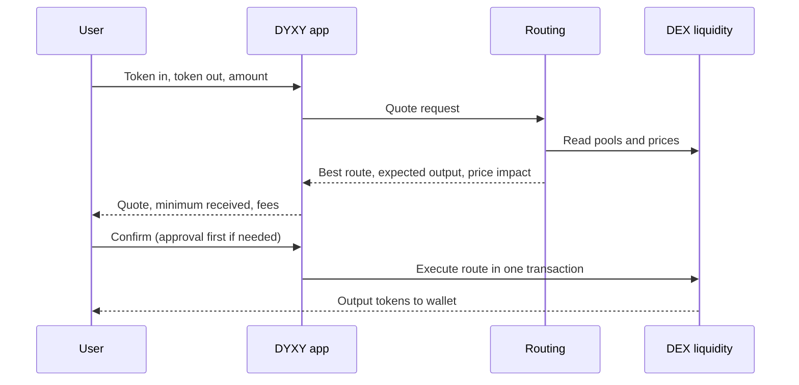

  

# DYXY Swap

How DYXY Swap aggregates liquidity across eight networks and executes market, limit and TWAP orders.

> This repository describes how the product works. It does not contain DYXY source code. User guide: [docs.dyxy.io/trade/swap](https://docs.dyxy.io/trade/swap/overview).

## Overview

DYXY Swap is a DEX aggregator. For every request it searches the liquidity available on the selected network, builds the route that returns the most tokens after fees and price impact, and executes it in one transaction. Tokens leave the user's wallet and the output returns to it in the same transaction.

| | Market | Limit | TWAP |
| --- | --- | --- | --- |
| Executes | Immediately | When the target price is reached | In equal parts on a schedule |
| Price | Best route now, within slippage | Target price or better | Market price at each interval, within an optional limit |
| Funds while waiting | — | Stay in the user's wallet | Unsold remainder stays under the user's control |
| Networks | 8 | 8 | 6 |

## Network support

| Network | Market | Limit | TWAP |
| --- | :---: | :---: | :---: |
| Ethereum | ✓ | ✓ | ✓ |
| BNB Chain | ✓ | ✓ | ✓ |
| Solana | ✓ | ✓ | ✓ |
| Arbitrum | ✓ | ✓ | ✓ |
| Base | ✓ | ✓ | ✓ |
| HyperEVM | ✓ | ✓ | — |
| Avalanche | ✓ | ✓ | — |
| Robinhood Chain | ✓ | ✓ | ✓ |

## Swap flow

## Documents

| Document | Contents |
| --- | --- |
| [Routing](docs/routing.md) | Multi-hop and split routes, how routes are compared |
| [Order types](docs/order-types.md) | Market, limit and TWAP in detail |
| [Slippage and price impact](docs/slippage.md) | Minimum received, tolerance guidelines, failure cases |

## Fees

Each swap carries a DYXY trading fee on the swapped amount, shown before confirmation. Fees of the underlying liquidity providers are already included in the quote. Network gas is paid to the network. Swaps are not part of the referral program.

## License

Text and diagrams in this repository are licensed under [CC BY 4.0](LICENSE). The DYXY name and logo are not covered by this license.
