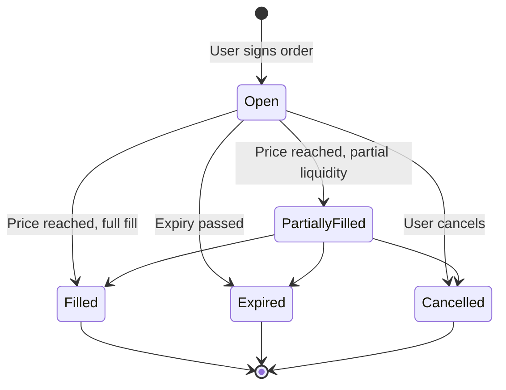

# Order types

## Market

A market order executes immediately along the best current route.

1. The user selects tokens and an amount.
2. The app shows the expected output, minimum received, price impact, route and fees.
3. On EVM networks, the first sale of an ERC-20 token requires a one-time approval. Native tokens and Solana need none.
4. The swap executes in one transaction. If the price moves beyond the slippage tolerance before inclusion, the transaction reverts and only gas is spent.

## Limit

A limit order swaps only at the user's target price or better.

| Property | Behavior |
| --- | --- |
| **Custody** | Tokens stay in the user's wallet while the order is open. They are not locked in a contract and are only swapped at execution |
| **Expiry** | Preset durations or a custom duration set by the user |
| **Execution** | At the limit price or better, onchain, output sent to the wallet |
| **Partial fills** | Possible when liquidity at the price is thin |
| **Requirements** | The full amount must remain in the wallet, and on EVM networks the token approval must stay in place |
| **Cancellation** | The user cancels and nothing more is swapped |

Available on all eight networks.

## TWAP

A TWAP (time-weighted average price) order splits a large swap into equal parts executed at a fixed interval.

| Parameter | Meaning |
| --- | --- |
| Total amount | Amount to sell in total |
| Number of trades | How many parts the total is split into |
| Interval | Time between two trades |
| Duration | Number of trades × interval |
| Price limit (optional) | A trade due at a worse price is skipped |

**Example.** 100,000 USDC to ETH in 20 trades every 15 minutes: 5,000 USDC is swapped every 15 minutes, and the order completes after 5 hours.

| | One market order | TWAP |
| --- | --- | --- |
| Price impact | Paid at once | Spread across small trades |
| Exposure to one moment's price | Full | Averaged |
| Speed | Instant | Full duration |

The order shows trades completed, amount sold, amount received and average price. Cancelling keeps executed trades and stops the rest.

Available on Ethereum, BNB Chain, Solana, Arbitrum, Base and Robinhood Chain.
