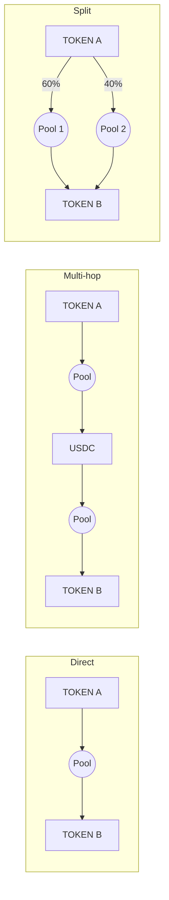

# Routing

When a user requests a quote, the router reads the liquidity available on the selected network, including AMM pools and concentrated liquidity pools, and compares possible routes by **net output**: what the user actually receives after price impact and liquidity provider fees.

## Route shapes

| Shape | When it is used |
| --- | --- |
| **Direct** | A deep pool exists between the two tokens |
| **Multi-hop** | No good direct pool exists, so the trade passes through an intermediate token such as USDC or the network's native token |
| **Split** | The trade is large relative to a single pool, so it is divided across several pools to reduce price impact |

Routes can combine both: a split route can contain multi-hop legs.

## Why net output, not headline price

A pool with the best spot price can still give a worse result if it is shallow, because the trade pushes its price further. A pool with a higher fee tier can still win if it has much more depth. Comparing routes by what the user receives captures all of this at once.

## What the user sees

The route panel shows each venue and hop, and the share of the trade that goes through each one. The expected output, minimum received and price impact refer to the route as a whole.

## Quote freshness

Prices change with every block. Quotes are refreshed automatically while the swap panel is open, and an expired quote is refreshed before execution.
